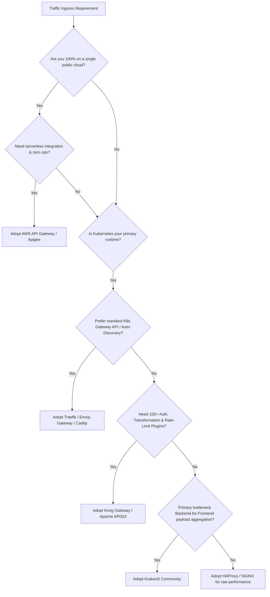

  

# 🌐 Awesome API Gateway & Reverse Proxy

  
  
  
  
  
  
  

> 🚀 A curated directory of top-tier **API Gateways**, **Reverse Proxies**, **Edge Routers**, and **Cloud-Native Ingress Controllers**. Designed for DevOps engineers, Site Reliability Engineers (SREs), system architects, and platform teams navigating high-throughput traffic routing, microservices communication, zero-trust API security, and dynamic service discovery.

---

## 📑 Table of Contents

- 📊 [Sector Overview & Market Dynamics](#-sector-overview--market-dynamics)
- ☁️ [SaaS & Managed API Gateway Platforms](#️-saas--managed-api-gateway-platforms)
- 🚀 [Open-Source API Gateways & Reverse Proxies](#-open-source-api-gateways--reverse-proxies)
- ⚖️ [Feature Comparison Matrix](#️-feature-comparison-matrix)
- 🧭 [Architecture Selection Guide: SaaS vs. Self-Hosted OSS](#-architecture-selection-guide-saas-vs-self-hosted-oss)
- 📈 [Star History](#-star-history)
- 💖 [Support & Sponsoring](#-support--sponsoring)
- 🤝 [How to Contribute](#-how-to-contribute)
- 📜 [Disclaimer & Community Notes](#-disclaimer--community-notes)

---

## 📊 Sector Overview & Market Dynamics

The global API Management and Gateway market is estimated at **$8.77 billion to $13.50 billion in 2026**, projected to surge past **$22 billion to $36 billion by 2031** at a compound annual growth rate (**CAGR**) of **16.4% to 22.3%**, propelled by microservices adoption, multi-cloud ingress demands, and edge AI proxy workloads. 

The industry remains **moderately fragmented** rather than winner-take-all: while hyperscalers (Google Cloud, AWS, Cloudflare) capture extensive managed and serverless enterprise volume, independent infrastructure software vendors (Kong, F5/NGINX) and an extraordinarily vibrant open-source ecosystem (Caddy, Traefik, Envoy, APISIX, HAProxy) command dominant developer mindshare and on-premise/hybrid Kubernetes deployments.

---

## ☁️ SaaS & Managed API Gateway Platforms

The following table benchmarks leading hosted and commercial API gateway platforms, ordered by company scale (**Valuation / Revenue** descending) to reflect institutional adoption, pricing predictability, and evaluation terms.

| 🏢 Platform / Vendor | 📈 Company Scale (Valuation / Revenue) | 💳 Specific Starting Pricing | 🎁 Free Tier / Trial Limits | 🎯 Primary Use Case & Architecture |
| :--- | :--- | :--- | :--- | :--- |
| **[Apigee (Google Cloud)](https://cloud.google.com/apigee)** | 🌐 **$2.1T+ Valuation** / $350B+ Annual Revenue *(Alphabet Inc.)* | **$365/month** base environment fee + $20/million calls (Pay-As-You-Go standard proxies) | **60-day Evaluation Tier**: full enterprise sandbox environment, up to 20 proxy deployments, no charge | Full-lifecycle API management, API monetization, and enterprise hybrid cloud governance in regulated environments. |
| **[Amazon API Gateway](https://aws.amazon.com/api-gateway/)** | 📦 **$2.0T+ Valuation** / $575B+ Annual Revenue *(Amazon.com, Inc.)* | **$1.00/million calls** for HTTP APIs; **$3.50/million calls** for REST APIs; WebSocket connection charges $0.25/million mins | **1,000,000 API calls/month** free for first 12 months (REST/HTTP) + 1M WebSocket messages/month | Serverless AWS-native gateway integrating directly with AWS Lambda, DynamoDB, Cognito, and VPC endpoints. |
| **[Cloudflare API Shield](https://www.cloudflare.com/products/api-shield/)** | 🛡️ **$32B+ Valuation** / $1.7B+ Annual Revenue *(Cloudflare, Inc.)* | **$20/month** (Pro plan base) / **$200/month** (Business plan base); Enterprise custom | **Free Forever Plan**: includes global Anycast reverse proxy, unmetered DDoS mitigation, free SSL/TLS, and 100,000 Worker requests/day | Edge-based reverse proxying, global DDoS protection, mTLS client authentication, and schema validation. |
| **[NGINX Plus](https://www.nginx.com/products/nginx/)** | ⚡ **$16B+ Valuation** / $2.8B+ Annual Revenue *(F5, Inc.)* | **$399/month per instance** ($4,788/year) subscription license including standard enterprise support | **30-day Free Trial**: unrestricted instance license with live activity monitoring and API-driven reconfig | Enterprise edge reverse proxy, dynamic upstream re-routing without restarts, active health checks, and session persistence. |
| **[Kong Konnect](https://konghq.com/products/kong-konnect)** | 🦍 **$2.0B Valuation** (Series E Unicorn) / ~$100M ARR *(Kong Inc.)* | **$25/month** for Serverless control plane ($200/month for Hybrid) with 1M requests included ($200/1M overage) | **Free Forever Tier**: 1 cloud control plane, 3 services, and 1,000,000 requests/month (plus 30-day Konnect Plus trial) | Multi-cloud control plane with distributed data planes, 100+ plugins (Auth, OIDC, Rate Limiting), and AI Gateway. |
| **[HAProxy Enterprise](https://www.haproxy.com/products/haproxy-enterprise-edition)** | 🏎️ **~$100M Valuation** / ~$40M ARR *(HAProxy Technologies)* | **$366/month per instance** ($0.50/hr on AWS Marketplace) or $4,392/year annual contract | **30-day Free Trial**: fully functional enterprise image with Application Security & Bot Modules | Extreme throughput L4/L7 load balancing, DDoS/botnet filtering, microsecond-level latency, and SLA-backed support. |
| **[Tyk Cloud](https://tyk.io/pricing/)** | 🔌 **~$60M Valuation** / ~$18M ARR *(Tyk Technologies)* | **$600/month** (Launchpad Tier) covering up to 10 million API calls/month and 100GB data transfer | **14-day Free Trial**: full access to cloud control plane, developer portal, and unlimited test calls (no credit card needed) | Battery-included OpenAPI-native API gateway with GraphQL federation, analytics dashboard, and zero vendor lock-in. |
| **[Traefik Enterprise & Hub](https://traefik.io/traefik-enterprise/)** | 🚦 **~$50M Valuation** / ~$12M ARR *(Traefik Labs)* | **$109/month** starting tier for Traefik Hub; cluster production tiers start from **~$1,000/month** | **30-day Free Trial**: unrestricted access to Traefik Hub and Enterprise API management dashboard | Cloud-native ingress, automated Let\'s Encrypt TLS certificate provisioning, distributed rate limits, and GitOps integration. |
| **[Ambassador Edge Stack](https://www.getambassador.io/products/edge-stack)** | ☸️ **~$35M Valuation** / ~$10M ARR *(Ambassador Labs)* | **$2,500/month** for production cluster gateway deployment with Gold Support SLA | **Free Forever Community Tier**: up to **5 requests per second (RPS)** with proprietary Single Sign-On (SSO) & OIDC | Kubernetes-native Envoy-based ingress controller, declarative CRD management, developer self-service, and Canary releases. |
| **[KrakenD Enterprise](https://www.krakend.io/enterprise/)** | 🐙 **~$25M Valuation** / ~$8M ARR *(Kraken Systems)* | **$1,099/month** ($13,188/year) predictable flat-rate contract with zero per-request or bandwidth surcharges | **30-day Free Trial**: fully functional Enterprise runtime binary with FIPS, OpenAPI generation, and AI gateway modules | Stateless high-performance API aggregation engine (40k–80k RPS/node), Backend-for-Frontend (BFF), and JSON manipulation. |

---

## 🚀 Open-Source API Gateways & Reverse Proxies

The following curated open-source projects are sorted by **GitHub Stars_Count (descending)**. Every repository includes a direct link to its stargazers page via its social badge.

### 1. [Caddy](https://github.com/caddyserver/caddy) 
* 📜 **License**: Apache-2.0 | 💻 **Primary Language**: Go
* 🏛️ **Architecture**: Modern, fast, and secure HTTP/2 & HTTP/3 reverse proxy and enterprise web server.
* 🛠️ **Key Capabilities**: Automatic HTTPS by default (via Let's Encrypt / ZeroSSL), dynamic configuration via JSON REST API or Caddyfile, native reverse proxy load balancing with passive/active health checks, and modular architecture.
* 🎯 **Best For**: Developers and platform teams who want zero-configuration TLS automation and an elegant alternative to legacy web servers.

### 2. [Traefik](https://github.com/traefik/traefik) 
* 📜 **License**: MIT | 💻 **Primary Language**: Go
* 🏛️ **Architecture**: Cloud-native dynamic edge router and reverse proxy.
* 🛠️ **Key Capabilities**: Real-time automatic service discovery across Docker, Kubernetes, Consul, Nomad, and Etcd. Generates routing rules on the fly without service restarts. Built-in web UI, automatic Let's Encrypt certificates, circuit breakers, retries, and comprehensive Prometheus metrics.
* 🎯 **Best For**: Microservices deployments on Kubernetes and Docker Swarm needing hitless dynamic routing.

### 3. [Kong Gateway (OSS)](https://github.com/Kong/kong) 
* 📜 **License**: Apache-2.0 | 💻 **Primary Language**: Lua / C (OpenResty/NGINX)
* 🏛️ **Architecture**: Plugin-extensible cloud-native API gateway built on top of OpenResty engine.
* 🛠️ **Key Capabilities**: Supports both traditional database-backed mode (PostgreSQL) and DB-less GitOps mode (`decK`). Rich ecosystem of 100+ open-source plugins for authentication (JWT, Key, Basic), rate limiting, traffic transformations, and logging.
* 🎯 **Best For**: Enterprise teams seeking a battle-tested API gateway with an extensive ecosystem of community plugins.

### 4. [NGINX](https://github.com/nginx/nginx) 
* 📜 **License**: 2-Clause BSD | 💻 **Primary Language**: C
* 🏛️ **Architecture**: The world's most widely deployed event-driven HTTP server, reverse proxy, and mail proxy.
* 🛠️ **Key Capabilities**: Asynchronous non-blocking event-driven loop capable of serving hundreds of thousands of concurrent connections. SSL/TLS termination, HTTP/2, HTTP/3 (QUIC), fast FastCGI/uWSGI proxying, and caching.
* 🎯 **Best For**: Core Internet edge routing, high-performance static caching, and high-concurrency reverse proxying.

### 5. [Envoy Proxy](https://github.com/envoyproxy/envoy) 
* 📜 **License**: Apache-2.0 | 💻 **Primary Language**: C++
* 🏛️ **Architecture**: CNCF graduated high-performance L4/L7 service and communication bus.
* 🛠️ **Key Capabilities**: Dynamic configuration via discovery services (xDS APIs), out-of-process architecture, advanced load balancing (health checking, outlier detection, circuit breaking), first-class HTTP/2 and gRPC support, and deep observability.
* 🎯 **Best For**: Large-scale service meshes (e.g., Istio) and foundational backplanes for modern Kubernetes gateway controllers.

### 6. [Pingora](https://github.com/cloudflare/pingora) 
* 📜 **License**: Apache-2.0 | 💻 **Primary Language**: Rust
* 🏛️ **Architecture**: Cloudflare's memory-safe, ultra-high-throughput asynchronous multithreaded network services framework.
* 🛠️ **Key Capabilities**: Engineered to handle over a trillion requests per day at Cloudflare scale. Provides programmable HTTP/1, HTTP/2, and TLS termination primitives with zero memory-safety vulnerabilities, low CPU overhead, and high efficiency.
* 🎯 **Best For**: Systems engineers building custom, high-speed reverse proxies and edge routing infrastructure in Rust.

### 7. [Apache APISIX](https://github.com/apache/apisix) 
* 📜 **License**: Apache-2.0 | 💻 **Primary Language**: Lua / Go / Python / Java
* 🏛️ **Architecture**: Dynamic, real-time, high-performance API gateway built on NGINX and etcd.
* 🛠️ **Key Capabilities**: Hot-reloading of routing rules and SSL certificates without server restarts, multi-protocol routing (HTTP, gRPC, WebSocket, MQTT, Dubbo), multi-language plugin runner support, and built-in Canary/traffic-splitting capabilities.
* 🎯 **Best For**: High-throughput distributed API traffic management and Kubernetes ingress routing.

### 8. [Zuul](https://github.com/Netflix/zuul) 
* 📜 **License**: Apache-2.0 | 💻 **Primary Language**: Java
* 🏛️ **Architecture**: Netflix's L7 application gateway and edge service framework.
* 🛠️ **Key Capabilities**: Zuul 2 runs asynchronously on Netty non-blocking I/O. Uses customizable filter pipelines (inbound, endpoint, outbound) to execute dynamic routing, token authentication, request profiling, and server-to-client push messaging (WebSocket/SSE).
* 🎯 **Best For**: JVM-based microservices ecosystems and Spring Cloud production environments operating at high scale.

### 9. [Tyk Gateway (OSS)](https://github.com/TykTechnologies/tyk) 
* 📜 **License**: MPL-2.0 | 💻 **Primary Language**: Go
* 🏛️ **Architecture**: Batteries-included open-source enterprise API gateway.
* 🛠️ **Key Capabilities**: Zero third-party runtime dependencies aside from Redis for distributed token and rate-limit tracking. Supports REST, SOAP, GraphQL, gRPC, and TCP. Features hitless zero-downtime hot reloads, OpenAPI 3.0 specification scaffolding, and multi-language plugin hooks.
* 🎯 **Best For**: Engineering teams wanting a 100% open-source gateway with zero feature lockouts on core functionality.

### 10. [Fabio](https://github.com/fabiolb/fabio) 
* 📜 **License**: MIT | 💻 **Primary Language**: Go
* 🏛️ **Architecture**: Fast, zero-configuration HTTP(S) and TCP reverse proxy router designed specifically for HashiCorp Consul.
* 🛠️ **Key Capabilities**: Automatically registers routes based on tags published in Consul service discovery. Zero manual configuration files required, handles traffic rebalancing dynamically, and includes built-in web UI and TLS SNI dispatching.
* 🎯 **Best For**: Infrastructure stacks tightly integrated with HashiCorp Nomad and Consul.

### 11. [HAProxy (Community)](https://github.com/haproxy/haproxy) 
* 📜 **License**: GPL-2.0 | 💻 **Primary Language**: C
* 🏛️ **Architecture**: The benchmark open-source reverse proxy and TCP/HTTP load balancer.
* 🛠️ **Key Capabilities**: Single-threaded, event-driven, non-blocking I/O engine renowned for predictable low latency and rock-solid memory stability under massive concurrent connection loads. Provides comprehensive health checking, round-robin/least-conn/hash algorithms, and rich runtime statistics.
* 🎯 **Best For**: Bare-metal and high-performance load balancing tiers where resource efficiency is paramount.

### 12. [Spring Cloud Gateway](https://github.com/spring-cloud/spring-cloud-gateway) 
* 📜 **License**: Apache-2.0 | 💻 **Primary Language**: Java
* 🏛️ **Architecture**: Reactive API gateway built on Spring Boot 3, Spring WebFlux, and Project Reactor.
* 🛠️ **Key Capabilities**: Declarative route matching on HTTP attributes (headers, method, host, query parameters), non-blocking execution model, built-in rate limiting using Redis, circuit breaking via Resilience4j, and seamless integration into Spring ecosystem discovery clients (Eureka, Consul).
* 🎯 **Best For**: Enterprise Java engineering teams running Spring Boot microservice architectures.

### 13. [Emissary-Ingress](https://github.com/emissary-ingress/emissary) 
* 📜 **License**: Apache-2.0 | 💻 **Primary Language**: Go / Python
* 🏛️ **Architecture**: CNCF Incubating Kubernetes-native API gateway and ingress controller built on Envoy Proxy.
* 🛠️ **Key Capabilities**: Declarative CRD-driven configuration allowing developers to control ingress paths next to their service manifests (`Mapping`, `TCPMapping`, `Host`). Designed for GitOps continuous delivery workflows.
* 🎯 **Best For**: Kubernetes-first platforms requiring native CRD configurations without vendor lock-in.

### 14. [Vulcand](https://github.com/vulcand/vulcand) 
* 📜 **License**: Apache-2.0 | 💻 **Primary Language**: Go
* 🏛️ **Architecture**: Programmatic, extendable reverse proxy for microservices.
* 🛠️ **Key Capabilities**: Backed by etcd for storing routes, middlewares, and upstream servers. Supports dynamic middleware plugins (rate limits, basic auth, rewrites) registered at runtime through command-line or REST APIs without restarts.
* 🎯 **Best For**: Legacy distributed environments centered around Etcd coordination.

### 15. [Envoy Gateway](https://github.com/envoyproxy/gateway) 
* 📜 **License**: Apache-2.0 | 💻 **Primary Language**: Go
* 🏛️ **Architecture**: The official Kubernetes Gateway API implementation managed by the Envoy project.
* 🛠️ **Key Capabilities**: Implements standard Kubernetes `GatewayClass`, `Gateway`, and `HTTPRoute` resources. Extends functionality via CRDs such as `BackendTrafficPolicy` (circuit breakers, rate limiting) and `SecurityPolicy` (mTLS, JWT, OIDC), abstracting away raw Envoy xDS complexity.
* 🎯 **Best For**: Modern Kubernetes clusters adopting the official Kubernetes Gateway API standard.

### 16. [KrakenD (Community)](https://github.com/krakend/krakend-ce) 
* 📜 **License**: Apache-2.0 | 💻 **Primary Language**: Go
* 🏛️ **Architecture**: Ultra-high-performance stateless API gateway focused on Backend-for-Frontend (BFF) aggregation.
* 🛠️ **Key Capabilities**: Single Go binary with zero database dependencies. Aggregates, merges, transforms, and filters multiple upstream REST/gRPC responses into a single client payload in a single network pass. Capable of 40,000–80,000 RPS per node.
* 🎯 **Best For**: Mobile and frontend teams needing high-speed response aggregation and payload transformation without database overhead.

### 17. [Kong Kubernetes Ingress Controller](https://github.com/Kong/kubernetes-ingress-controller) 
* 📜 **License**: Apache-2.0 | 💻 **Primary Language**: Go
* 🏛️ **Architecture**: Ingress controller synchronizing Kubernetes cluster ingress definitions into Kong Gateway runtime.
* 🛠️ **Key Capabilities**: Supports Kubernetes Ingress and Kubernetes Gateway API standards. Allows attaching Kong plugins (OAuth2, rate limiting, key auth) directly to Kubernetes services and routes via `KongPlugin` CRDs.
* 🎯 **Best For**: Kubernetes platform operators running Kong Gateway as their ingress data plane.

### 18. [Gravitee API Management](https://github.com/gravitee-io/gravitee-api-management) 
* 📜 **License**: Apache-2.0 | 💻 **Primary Language**: Java
* 🏛️ **Architecture**: Flexible, open-source API management platform covering synchronous and event-driven architectures.
* 🛠️ **Key Capabilities**: Supports both traditional request-response APIs (REST, SOAP, GraphQL) and real-time streaming protocols (Kafka, MQTT, WebSockets). Offers policy studio UI, developer portal, and analytics.
* 🎯 **Best For**: Hybrid architectures requiring unified governance across RESTful APIs and event-driven message brokers.

---

## ⚖️ Feature Comparison Matrix

| 🛠️ Project / Gateway | 🚪 Ingress Type | ⚙️ Configuration Mode | 🔒 Automatic TLS | 🧩 Extensibility / Plugins | 📦 Runtime Footprint | 💡 Primary Differentiator |
| :--- | :--- | :--- | :--- | :--- | :--- | :--- |
| **Caddy** | Edge / Reverse Proxy | Caddyfile / REST API | Native ACME (Zero-Config) | Go plugins | ~30MB RAM | Instant HTTPS & developer ergonomics |
| **Traefik** | Edge / Ingress | Dynamic Discovery / CRD | Native ACME | Go / WebAssembly plugins | ~50MB RAM | Orchestrator auto-discovery |
| **Kong (OSS)** | API Gateway / Ingress | decK (GitOps) / Admin API | Via Cert-Manager / Lua | 100+ Lua / Go / JS plugins | ~150MB RAM | Deepest plugin ecosystem |
| **NGINX** | Web Server / Proxy | Static Conf Files | Manual / Certbot | C modules / Lua | ~15MB RAM | Raw HTTP concurrency standard |
| **Envoy Proxy** | Service Mesh / Ingress | xDS dynamic gRPC APIs | Dynamic via SDS | C++ / Wasm filters | ~40MB RAM | Programmable service mesh engine |
| **Pingora** | Custom Edge Proxy | Rust Code / Library | Custom OpenSSL/BoringSSL | Rust traits & async hooks | Ultra-Low / Custom | Memory-safe extreme concurrency |
| **Apache APISIX** | API Gateway / Ingress | etcd / Admin API | Dynamic SSL via etcd | Lua / Go / Python / Java | ~80MB RAM | Hot-reloading & multi-lang plugins |
| **HAProxy** | L4/L7 Load Balancer | haproxy.cfg / Runtime CLI | Native SNI / Certbot | Lua / Native C | ~10MB RAM | Predictable microsecond latency |
| **Envoy Gateway** | K8s Gateway API | K8s CRDs (Gateway API) | K8s Cert-Manager | EnvoyFilters / Wasm | ~50MB RAM | Official Envoy Kubernetes Gateway |
| **KrakenD** | BFF / API Gateway | Declarative JSON / YAML | Native / LetsEncrypt | Go plugins | ~20MB RAM | Stateless response aggregation |

---

## 🧭 Architecture Selection Guide: SaaS vs. Self-Hosted OSS

When evaluating whether to adopt a managed SaaS gateway or deploy an open-source solution, consider the total cost of ownership (TCO) across three fundamental pillars:

1. ⚙️ **Operational Maintenance Overhead**:
   * **Self-hosted OSS** (Kong, Envoy, APISIX) eliminates software licensing fees, but requires engineering capacity for high-availability database management (e.g., PostgreSQL for Kong), zero-downtime upgrades, security patch compliance, and scaling control planes.
   * **Managed SaaS** (Kong Konnect, Tyk Cloud, Apigee) shifts control-plane uptime, automated backups, and version upgrades to the vendor, allowing platform engineers to focus on API design and security policies.

2. 🔒 **Latency & Data Sovereignty**:
   * For strict regulatory frameworks (GDPR, HIPAA, PCI-DSS), hybrid architectures (e.g., Kong Konnect with self-hosted data planes or Apigee Hybrid) guarantee that decrypted customer payloads never leave your private VPC, while metadata and governance remain centralized.

3. 🚀 **BFF (Backend-for-Frontend) vs. Gateway Management**:
   * If your goal is aggregating multiple microservice calls into one mobile-optimized JSON payload, **KrakenD** outperforms traditional gateways by eliminating database bottlenecks.
   * If your goal is developer portals, API key monetization, and team access delegation, **Tyk**, **Kong**, or **Apigee** provide complete lifecycle platforms.

---

##  Star History

---

## 💖 Support & Sponsoring

A huge **thank you** 🙏 to everyone exploring, using, and contributing to this ecosystem guide! 

If you find this curated directory helpful for your team, platform engineering journey, or microservice architecture:
- ⭐ **Star** this repository to help others discover it on GitHub.
- 🍴 **Fork** it and submit new tools, benchmarks, and updates.
- 📢 **Share** it with your engineering colleagues, DevOps communities, and on social channels.
- ☕ **Buy me a coffee / Sponsor**: Support ongoing maintenance, research, and open-source curation directly via the [GitHub Sponsors Dashboard](https://github.com/sponsors/ishandutta2007). Every sponsorship helps keep this directory fresh, accurate, and completely free!

---

## 🤝 How to Contribute

We welcome additions, corrections, and ecosystem updates from the community!

1. 🍴 **Fork** this repository.
2. 🔍 Check existing entries in [README.md](file:///C:/Users/ishan/Documents/Projects/Awesome-API-Gateway-Reverse-Proxy/README.md) to preserve alphabetical and star-count sorting standards.
3. 📝 Add your entry with:
   - Official product or repository link
   - Shields.io social Stars_Badge (for open-source entries: ``)
   - Precise pricing and free-tier limits (for SaaS entries)
   - 2–3 factual sentences outlining architectural trade-offs.
4. 🚀 Submit a **Pull Request** with a descriptive summary of your changes.

---

## 📜 Disclaimer & Community Notes

- ⚖️ This repository is maintained as an open community resource and does not constitute a commercial endorsement.
- 📊 All pricing metrics, tier quotas, and corporate valuations reflect publicly documented figures as of late 2026 and may be updated periodically by respective vendors.
- 🛡️ Always perform your own synthetic load tests and security threat models before selecting an API gateway or reverse proxy for production traffic.
